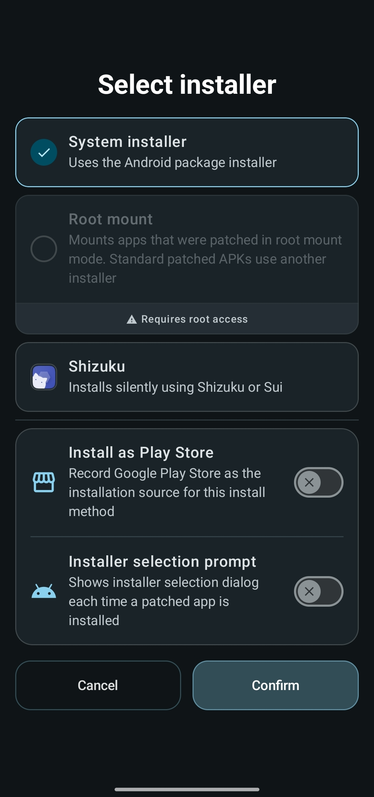
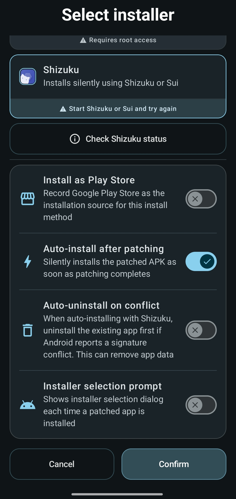

# Choosing how patched apps are installed

Morphe patches the APK, but something else has to put it on your device. That something is
the installer, and which one you pick decides whether installing takes a confirmation dialog
or happens silently, whether the original app survives, and what happens when a new version
of the app comes out.

The default works everywhere and needs no setup. Read on if you have root or Shizuku, or if
Google Play keeps trying to overwrite your patched build.

## Where the setting lives

Open **Settings → Installation**. The **Default installer** section lists everything available
on your device, with the shared options underneath. The row in the settings shows the installer
you picked.

  

Options your device cannot use are greyed out with the reason underneath, for example
**Install Shizuku or Sui to use this option**. Tap one to select it, there is nothing to
confirm.

## The installers

### System installer

The Android package installer, and the default. Android shows its usual confirmation screen,
and the first time you install anything from Morphe it asks you to allow installs from
unknown sources.

This works on every device with no extra software. The trade-off is a confirmation tap for
every install, and if the unpatched app is still installed you have to uninstall it first,
because the patched build is signed with a different certificate.

### Root mount

Only selectable on rooted devices, and only for apps that were patched in root mount mode.
See [Root mount](#root-mount-in-detail) below, it works differently from every other option
here.

### Shizuku

Installs silently through [Shizuku](https://shizuku.rikka.app/), Shizuku+ or Sui, with no
confirmation dialog at all. One of them has to be installed, running, and have granted Morphe
permission, Morphe tells you which of those is missing.

  

**Check Shizuku status** opens a breakdown of the current state: the mode and the provider it
came from, whether it is installed, supported, and running, and whether permission is granted,
with buttons to request permission or open the Shizuku app.

### Third-party installers

Any installer app detected on your system also shows up in the list. Morphe hands the APK
over and waits for that app to report the result.

## The shared options

Below the installer list are the settings that apply to whichever installer you selected.
**Install as Play Store** sits right under the list, the rest are grouped under **Patching**.

### Install as Play Store

Records Google Play Store as the installation source for the patched app. This can help
services that check the install source, for example Android Auto, though it is not
guaranteed on every app, device, ROM, or Android version.

> [!WARNING]
> With Play Store recorded as the source, Play may offer updates for the patched app.
> Installing such an update overwrites your patched APK with the original and removes every
> patch. If you use this, open the app's Play Store page, tap the three-dot menu, and choose
> **Turn off updates**.

Morphe shows this warning and asks you to confirm before enabling the option.

### Auto-install after patching

The patched APK is installed the moment patching finishes, without you returning to the app.
Shizuku does this for any install. The system installer manages it only where Android lets
Morphe update an app it installed itself, which means replacing a build Morphe put there,
with the same signature and no installer prompt in the way. Anything else still opens the
usual confirmation.

### Auto-uninstall on conflict

Shizuku only, and off by default. When a silent install fails because the installed app has
a different signature, Morphe uninstalls the existing app first and then installs the
patched one.

> [!WARNING]
> This erases that app's data. If the patched APK then fails to install for another reason,
> the previous app is already gone.

### Install anyway

Rooted devices only. The signature conflict dialog offers **Install anyway** next to
**Uninstall**, which installs over the existing app and keeps its data.

Root alone is not enough for this to succeed. Android still verifies the certificate, so the
install only goes through on devices running a module that patches that verification out of the
framework. Without one, the install is rejected and the conflict dialog comes back.

### Installer selection prompt

Asks how to install every app instead of committing to one default. On a rooted device the
question comes before patching, since root mount has to be decided then, otherwise it comes
when the patched app is installed.

## Root mount in detail

Root mount does not install the patched app at all. The unpatched app stays installed, and
Morphe bind-mounts the patched APK over it. Android keeps seeing the stock app: same package,
same signature, same data directory.

That buys you two things ordinary installs cannot offer:

- **Updates without data loss.** Since the app's data belongs to the stock app, replacing the
  patched layer never touches it.
- **No GmsCore needed.** The patched app runs under the stock app's identity, so patches that
  normally require GmsCore work without it.

Morphe writes a Magisk-style module for each mounted app, so the mount is restored
automatically after a reboot. The module also covers a restart of the Android framework without
a reboot, which some ROMs and modules offer as a soft reboot: it lifts the mount while the system
starts again, so Android does not take the patched APK for a broken install and remove the app,
and mounts it back once the system is up.

### Choosing the mode

Root mount is decided **before** patching, not in the installer settings. On a rooted device
Morphe shows a **Choose patch mode** dialog when you start patching:

- **Root mount mode** - patches for mounting over the stock app.
- **Standard install mode** - patches as a normal APK with GmsCore support, and your
  installer setting is used afterwards.

> [!IMPORTANT]
> The patch mode is separate from **Settings → Installation** and cannot be changed after
> patching. To switch, patch the app again in the other mode.

In root mount mode the APK download step also changes: you **do** install the original APK,
because the stock app has to be present for the patched one to mount over it. In standard
mode you leave the downloaded APK uninstalled.

### Managing a mounted app

Open the app's info dialog from its card on the Morphe home screen. A mounted app is marked
with a **Mount** chip and offers **Remount** and **Unmount**, an unmounted one offers
**Mount**. Unmounting leaves you with the plain stock app, mounting brings the patches back.

### Limits and gotchas

- **Branding cannot be changed.** A custom app icon or display name does not apply to a
  mounted install, see [Creating a custom app icon](custom-app-icon.md).
- **Versions must match.** The installed stock app has to be the exact version the patched
  APK was built from. If they drift apart, Morphe refuses to mount and tells you which
  version to install.
- **KernelSU and APatch users**: disable module unmounting or hiding for apps installed with
  root mount. Otherwise the stock app may keep running even though Morphe reports it as
  mounted. With [NoMount](https://github.com/maxsteeel/nomount) 2.2.0 or newer installed,
  Morphe redirects the app to the patched APK in the kernel instead of mounting it, which
  module unmounting does not affect and the mount table does not show. Keep the app off
  NoMount's own exclusion list, or it sees the stock APK.
  To keep the mount table clean, turn on **NoMount only** in **Settings → Installation**. A
  preinstalled app's system copy is then redirected to the stock APK with NoMount as well, and
  when NoMount is missing or its redirect fails the app stays unmounted instead of being bind
  mounted. The setting applies to an app the next time it is mounted or installed, and a stock
  APK mounted over the system copy before stays there until the next reboot.
- The **Root mount** entry in the installer list only handles apps that were patched in
  root mount mode. Standard patched APKs still go through whichever other installer you
  selected.

## Which one should I use?

| Situation | Pick |
| --- | --- |
| No root, no Shizuku | **System installer** |
| You want installs without confirmation taps | **Shizuku** |
| Rooted, and you want to keep app data across updates | **Root mount** (chosen before patching) |
| A service refuses to work unless the app came from Play | **Install as Play Store**, and turn off Play updates for that app |
| You switch between methods often | Enable **Installer selection prompt** |

## Troubleshooting

| Problem | What to do |
| --- | --- |
| "Uninstall required" or a signature conflict | The unpatched app is still installed. Uninstall it, which erases its data, or use root mount instead. On rooted devices you can also try **Install anyway** |
| Shizuku option is greyed out | Shizuku or Sui is not installed, not running, or has not granted Morphe permission. **Check Shizuku status** shows which |
| "Your preferred installer is unavailable" | Fix the underlying issue and retry, or let Morphe fall back to the standard installer |
| Play Store replaced the patched app with the original | Turn off updates for that app on its Play Store page. Tap the notification or open the app in Morphe and use **Restore** to reinstall the matching stock version and remount |
| Mount fails with a version mismatch | Install the stock version that matches the patched APK, then mount again |
| "NoMount driver protocol ... is outdated" | Update NoMount to 2.2.0 or newer and reboot the device |
| Morphe says the app is mounted but the stock app still runs | On KernelSU or APatch, disable module unmounting or hiding for that app, or install NoMount 2.2.0 or newer. With NoMount, take the app off its exclusion list |

## Next steps

- [Patching an app in Simple mode](patching-simple-mode.md)
- [Patching an app in Expert mode](patching-expert-mode.md)
- [Updating a patched app](updating-patched-apps.md)
- [Creating a custom app icon](custom-app-icon.md)
