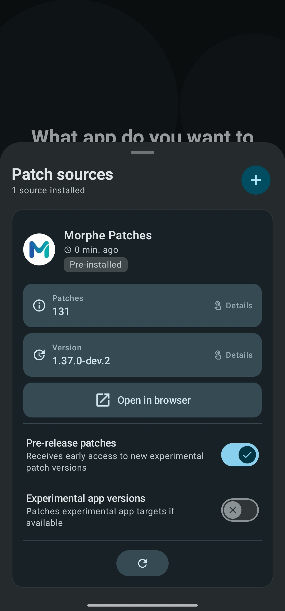
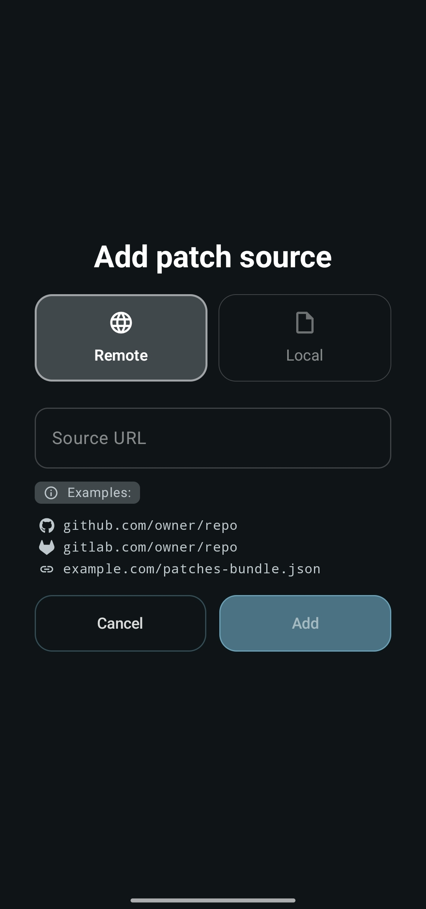
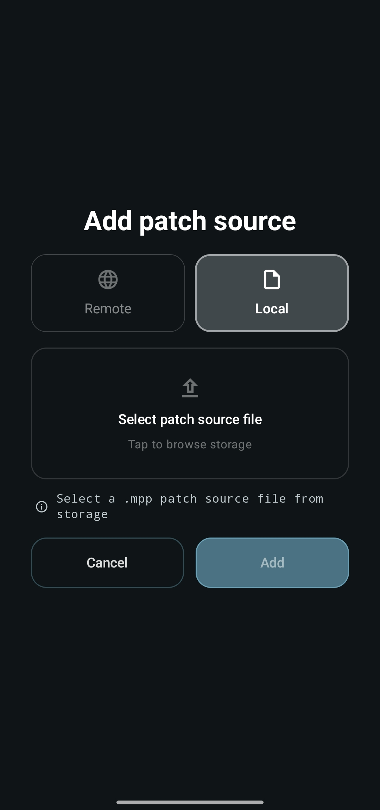

# Managing patch sources

A patch source is the bundle of patches Morphe applies to an app. Morphe ships with one
pre-installed source, **Morphe Patches**, and that is all most people ever need. You can add
more if you want patches from another maintainer, or a bundle you built yourself.

## The Sources page

Tap **Sources** in the bottom bar. The page lists every source you have, with the count in the
subtitle, a **+** button to add another, and a search through sources and their patches.

<p align="center">
  
</p>

Each card shows when the source was last updated, and a **Pre-installed** badge on the one
that ships with Morphe. With more than one source the cards fold, tap one to open it.

### What is on a source card

- **Patches** - how many patches the source provides. Tap the row to list them all.
- **Version** - the version currently installed. Tap the row to open its changelog.
- **Apps** - how many apps the source brings, shown as `3/232` once some are unticked, and as
  `3/232 · 2 new` while apps it started supporting wait to be looked at. Tapping it opens the
  list described in [Choosing which apps a source brings](#choosing-which-apps-a-source-brings).
- **Open in browser** - opens the source's repository or metadata URL.
- **Report an issue** - opens the issue tracker of that source, so a broken patch is reported
  to the people who wrote it rather than to Morphe.
- **Share** - shares a link that adds the source on another device, see the deep links under
  [Remote](#remote). Offered for sources added from a repository.

A card can also carry a badge explaining why the source is not pulling its weight:

| Badge | What it means |
| --- | --- |
| **Metadata N/A** | The remote metadata could not be read. Patching with the bundle you already have still works, auto-update does not |
| **Update Morphe** | The source needs a newer patcher than this build of Morphe carries |
| **Crashed** | The source crashed Morphe while loading and is being skipped. Update or re-import it to try again |
| **Blocked** | The source is on the block list and its patches are not used |

### The toggles

**Pre-release patches** gives this source early access to new experimental patch versions.
With it off you only receive stable releases. It appears on sources that publish
pre-releases at all.

> [!NOTE]
> This is per source. The **Pre-release updates** setting in the **Updates** section of the
> settings is a different thing, it controls early access to new versions of the Morphe app
> itself.

**Experimental app versions** makes this source patch experimental app targets when it has
them, so Morphe recommends a newer app version whose patches are still being refined. It
only appears when the source actually declares experimental targets, and on remote sources
it requires **Pre-release patches** to be on first, which is why it can disappear when you
turn that off.

> [!TIP]
> Expect quirks with experimental targets. Leave this off if you want the version the
> patches were tested against, see
> [Pick an APK version](patching-expert-mode.md#3-pick-an-apk-version).

### The action buttons

The pill row at the bottom of a card holds the actions available for that source:

| Icon | Action | Shown for |
| --- | --- | --- |
| circular arrow | **Update** - fetch the newest version now, or pick a replacement file for a local source | Remote and local sources |
| crossed circle / check | **Disable** or **Enable** - keep the source without using its patches | Any source, once you have more than one |
| pencil | **Rename** - give the source your own display name | Sources you added |
| trash | **Delete** - remove the source, with a confirmation | Sources you added |

The pre-installed source cannot be renamed or deleted.

Long-press a card to select it, then tap other cards to add them. The bar that appears updates,
disables, enables, or deletes every selected source at once, and **Reorder list** lets you drag
them into place.

## Adding a source

Tap **+** and pick where the bundle comes from.

### Remote

<p align="center">
  
</p>

Paste the address, or several at once to add them all. Morphe accepts a GitHub or GitLab
repository, or a direct link to a bundle's JSON metadata:

```
github.com/owner/repo
gitlab.com/owner/repo
example.com/patches-bundle.json
```

The field validates as you type and tells you whether the URL is usable before **Add**
becomes available. A repository URL also lets Morphe keep the source updated automatically.

A source can also arrive as a deep link, which carries the repository in the address:

```
https://morphe.software/add-source?github=owner/repo
https://morphe.software/add-source?gitlab=owner/repo
```

An optional `&name=` sets the display name, and an optional `&app=` with a package name adds
the source for that one app: its other apps, the ones it adds later included, are left out from
the start, see [New apps](#new-apps). The **Add** button next to an app on the community
patches website opens such a link. If the source is already added, the link brings that app
back to it instead. Opening a link hands the repository to Morphe, which asks **Do you want to
add this patch source to Morphe?** before anything is added. Only GitHub and GitLab repositories are
accepted this way.

**Community patches** opens the community patches website, where third-party sources can be
added with one tap through such a link. Morphe reminds you first that it does not review or
verify those patches.

> [!WARNING]
> Only add sources you trust. A patch source decides what ends up inside your patched apps.

### Local

<p align="center">
  
</p>

Pick one or more `.mpp` patch bundles from storage, **Add more files** adds further ones to the
same step. Local sources never update on their own: when a new file comes out, tap **Update**
on the source card and pick it. A new version of a local source is recognized by its bundle
name, so picking it here or opening it from a file manager offers to update that source instead
of adding a second one, and its patch selection and options stay as they were.

#### Updating from a computer

When you build patches yourself, the new file can be handed to Morphe over `adb`. Push it, look
up its id in the media store, and open it:

```
adb push patches.mpp /sdcard/Download/latest.mpp
adb shell content query --uri content://media/external/file --projection _id:_display_name
adb shell am start -a android.intent.action.VIEW -t application/vnd.ms-project \
  --grant-read-uri-permission -d content://media/external/file/<id> \
  -n app.morphe.manager/app.morphe.manager.MainActivity
```

Morphe asks to update the local source with that bundle name, which takes one tap. It always
asks, since any app can open a file this way.

### Choosing which apps a source brings

Some sources carry patches for hundreds of apps when you only want one or two. Tick **Pick
which of its apps to keep once the source has loaded** before tapping **Add**, and once the
source has loaded Morphe opens a list of every app it has patches for. The same choice is offered in the confirmation shown for a deep link or a
`.mpp` file opened from a file manager, and the list is always one tap away from the **Apps**
row on the source card.

The list works like a patch list. A ticked app is brought by the source, and each app shows how
many patches the source has for it. Tap an app to leave it out of this source, and tap it again
to bring it back. The button in the header brings back every app the search left, or leaves
them all out once all of them are brought. To keep a few apps out of hundreds, tap it once to
leave out everything, then tap the apps you want.

An app left out no longer comes from this source: the source is not offered when the app is
patched, the same as unticking it in [Choosing sources per app](#choosing-sources-per-app). An
app stays on the home screen while any source still brings it, and leaves once none does. It is
not in the **Hidden apps** list then, since nothing hid it: bring it back here instead. An app
you already patched keeps its card either way, and the list says so under it once it is left
out. Hide that card from the home screen if you no longer want it there.

#### New apps

By default a source brings every app it starts supporting, so a new app shows up on the home
screen with the update that adds it. Turn off **Bring new apps** at the top of the list and the
apps the source names from then on are left out as they arrive, as if you had left them out
yourself. The apps it names at that moment keep whatever you chose for them.

Apps left out this way are not hidden from you: the **Apps** row on the source card counts them
as new, and the list puts them first, marked **New**, until you close it. Bring one back the
same way as any other app. Turning the switch back on does not bring back the apps already left
out, only the ones that come after.

## Using more than one source

Extra sources change how patching behaves:

- **Simple mode** asks which source to use in a **Select patch source** dialog whenever more
  than one has patches for the app you tapped.
- **Expert mode** gives each source its own tab on the patch selection screen. The action
  buttons there apply to the tab you are viewing.

### Choosing sources per app

A source that is on is offered to every app it has patches for. If you patch YouTube from one
source and Reddit from another, you can say so per app instead of switching sources off
globally.

Long-press an app on the home screen, select as many as you like, and tap **Patch sources** in
the bar. The dialog lists the sources that have patches for them, and unticking one stops it
being offered to those apps. A source you untick keeps its patches and stays on everywhere
else, and the patches it adds later never join a selection for these apps on their own.

In Simple mode the **Select patch source** dialog offers the same thing in passing: tick
**Always use this source for this app** and the sources you turned down stop being offered, so
the dialog has nothing left to ask next time.

Every app needs one source left to patch from, so the last one cannot be unticked here. To drop
an app entirely, untick it in its source's app list instead.

Expert mode does not hide the fact: a source kept from the app is missing from the tabs, and a
notice above the list says how many. Tapping it shows them again for that run only, without
changing the decision.

> [!WARNING]
> Enabling patches from several sources for the same app is possible but risky. They are
> built independently and can conflict, so Morphe asks you to confirm before patching such a
> selection. Sticking to one source per app is the safe default.

The **Update** badge on a home card is tied to the source the app was patched with, see
[Updating a patched app](updating-patched-apps.md).

## Keeping sources up to date

Remote sources refresh in the background, and the **Update** pill on a card forces a check
right away. On devices without Google Play services the schedule is set by **Check frequency**
in **Settings → Notifications**. If **Mobile data updates** is off and you are not on Wi-Fi,
checks are skipped and Morphe warns you before patching with what may be an outdated bundle.

With two or more sources the header gets a sort button. **Sort** offers **Manual order**
(long-press a card to reorder), **Last updated**, **Name (A-Z)** and **(Z-A)**, and **Enabled
first**. **Filter** narrows the page to enabled or disabled sources, the ones with an update
waiting, or the ones that **Need attention** because they are blocked, failed to load, or need
a newer Morphe.

## Troubleshooting

| Problem | What to do |
| --- | --- |
| "This source has already been added" | The same URL is already in your list |
| "Invalid source URL" | The address must point to a GitHub or GitLab repository, or to a `.json` metadata file |
| **Blocked** badge on a source | The source is blocked and cannot be used. Remove it |
| **Metadata N/A** on a card | The remote metadata file is unavailable. Patching with the installed bundle still works, but this source will not auto-update |
| A patch shows an **Expert** badge | That patch is not part of the default selection. Enable Expert mode to include it manually |
| The file will not add | Local bundles must have the `.mpp` extension |

## Next steps

- [Patching an app in Expert mode](patching-expert-mode.md)
- [Updating a patched app](updating-patched-apps.md)
