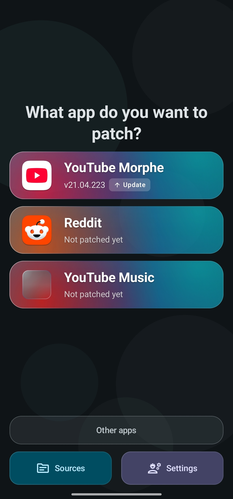
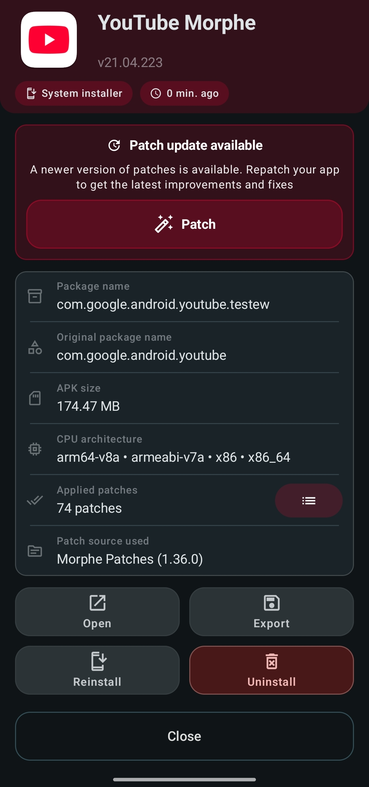

# Updating a patched app

Patches keep improving, and the apps they patch keep changing. Morphe tells you when your
patched build has fallen behind by putting an update mark on its home card.

Updating means patching again. The result installs straight over the app you already have,
without uninstalling and without losing its data.

## The update mark

  

The mark sits on the corner of the app icon and stands for either of two things:

- **Newer patches.** The patch source has a version newer than the one this app was patched
  with, and that version actually contains changes for this app. Morphe reads the source's
  changelog to check, so a patch release that only touches other apps does not put a mark on
  yours.
- **A newer supported app version.** The sources now cover a release of the app itself newer
  than the one you are running, see
  [Moving to a newer app version](#moving-to-a-newer-app-version) below.

For a newer app version the card also prints both numbers, the installed one, an arrow, and
the newer one, cut short when they do not fit. The app's info dialog spells both versions out
either way. With several apps behind, a banner above the list offers to re-patch them all at
once, see [When patches move on](batch-patching.md#when-patches-move-on).

Morphe can tell you about new releases while it is closed. **Settings → Notifications**
controls that:

- **Background update notifications** - notifies you about new Morphe and patch releases.
  They arrive as two separate notification categories, **Morphe updates** and **Patch
  updates**, so either can be silenced in Android's settings without the other.
  **Notification categories** opens them.
- **Check frequency** - hourly, daily, weekly, or monthly. Only shown on devices without
  Google Play services, where Morphe checks on a schedule instead of receiving a push.

The **Updates** section of the settings holds the rest:

- **Automatic updates** - what Morphe does when it opens:
  - **Download automatically** - checks and downloads patch updates on any network.
  - **Download on Wi-Fi only** - on mobile data it only checks and shows what is available.
  - **Check only** - shows the updates it found, and downloads them once you tap.
  - **Don't check** - checks only when you pull to refresh.

  Updates found but not downloaded wait on the home screen, and Morphe warns you if you patch
  with a source that has one waiting. Morphe updates are never downloaded on their own, and on
  mobile data only **Download automatically** skips the warning before downloading one.
- **Pre-release updates** - early access to new Morphe versions. Pre-release for individual
  patch sources is toggled per source in **Sources**.

## Updating

Tap the app's card to open its info dialog. The card at the top explains what changed and
offers the shortcut: **Patch update available** for newer patches, **App update available**
when it is the app itself that moved on.

  

Tap **Patch** and the normal patching flow starts. Two things make it shorter than the first
time:

- If Morphe kept the original APK, it offers **Use saved APK** and you skip the download
  entirely.
- Your patch selection and patch options are remembered, so Expert mode opens with the same
  choices as last time.

> [!TIP]
> Whether those copies exist is up to **Keep original APKs** and **Keep patched APKs** in
> **Settings → Storage management**, both on by default. With the first one off, every update
> means downloading the APK again.

In Simple mode, with a saved original of a version the patches support, **Patch** goes
straight to patching without asking anything.

With several apps behind at once, patch them in one queue instead of one at a time, see
[Patching several apps at once](batch-patching.md).

When patching finishes, install as usual. Android accepts it as an update to the existing
app because Morphe signs every build with the same keystore, so your data, logins, and
settings inside the patched app survive.

> [!IMPORTANT]
> That only holds while the keystore stays the same. Reinstalling Morphe or clearing its data
> generates a new one, and then patched builds no longer match what is installed, Android
> reports a signature conflict and the only way forward is uninstalling the patched app.
> Export your keystore from **Settings → Signing key** and keep it somewhere safe, see
> [Backing up Morphe and your keystore](backup-and-keystore.md).

### Root mount installs

An app patched in root mount mode is updated the same way, but the result is mounted over
the stock app instead of installed. Since the data belongs to the stock app, nothing is at
risk from the signature side at all. See
[Root mount](installers.md#root-mount-in-detail).

## What else is in the info dialog

Below the update card, the dialog shows what the current build is made of:

| Row | Meaning |
| --- | --- |
| **Package name** | The package the patched app is installed under |
| **Original package name** | The package it was patched from |
| **Newest supported** | The newest version of the app the enabled sources can patch |
| **APK size** | Size of the installed patched APK |
| **CPU architecture** | Architectures kept in the build |
| **Applied patches** | How many patches were applied, with a button that lists them |
| **Patch source used** | Which source and version produced this build |

The chips at the top show the installer that was used and how long ago the app was patched.

Under the update card there can be a second one, **Web links not verified**, when the patched
app handles web links Android has not verified for it. **Fix links** opens the system setting
that lets those links open in the app instead of the browser, and the **Supported web links**
row lower down shows how many are left.

The buttons at the bottom are:

- **Open** - launches the patched app.
- **Reinstall** (or **Install**, when the app is not on the device) - installs the saved
  patched APK again without patching.
- **Export** and **Share** - write the saved patched APK to storage, or hand it to another app.
- **Mount**, **Remount**, **Unmount** - for apps installed through root mount.
- **Uninstall** - removes the app from the device.
- **Delete** - removes the app from Morphe along with its saved APKs. Your patch selection and
  options are kept for future patching.

## Moving to a newer app version

Patches target specific app versions, so a newer YouTube release is only usable once the
patches declare support for it. When that happens the card is marked, and the info dialog
opens with **App update available** and both numbers: the version you are on, and the newest
one the sources support.

Tap **Patch** to move to it. This time the run works like a first patch rather than a repatch:
the original APK Morphe kept is of the old version, so it asks for the new one.

**Ignore** turns that particular version down. The mark and the banner go, the **Newest
supported** row keeps the number so you can still look it up, and the button beside it brings
the offer back. A version after it is offered again on its own, so ignoring is about one
release and not about the app.

In Expert mode you can see every supported version at once in the APK selection dialog,
including **Experimental** ones, see
[Pick an APK version](patching-expert-mode.md#3-pick-an-apk-version).

## Updating Morphe itself

Morphe checks for its own updates on the same schedule. When one is available, a **Morphe
update available** card appears at the top of the home screen, and from there Morphe
downloads and installs the new version itself. This is separate from patch source updates
and does not affect your patched apps.

## Troubleshooting

| Problem | What to do |
| --- | --- |
| No update mark although the source released a new version | The release contains no changes for this app, so there is nothing to repatch for |
| A mark for an app version you do not want | Open the app and tap **Ignore** in the update banner. The offer comes back for the version after it |
| "Patches may be outdated" before patching | A source has an update that **Automatic updates** left for you to download. Choose **Update & patch**, or tap the update on the home screen first |
| Signature conflict when installing the update | The keystore changed since the app was patched. Uninstall the patched app, which erases its data, then install the new build |
| The app was uninstalled outside Morphe | The card shows **Uninstalled**, and its info dialog **App was uninstalled**. Reinstall the saved build or patch it again |
| You want the previous build back | Install the APK you exported earlier. Saved copies are listed under **Settings → Storage management → Patched APKs** |

## Next steps

- [Choosing how patched apps are installed](installers.md)
- [Patching an app in Expert mode](patching-expert-mode.md)
